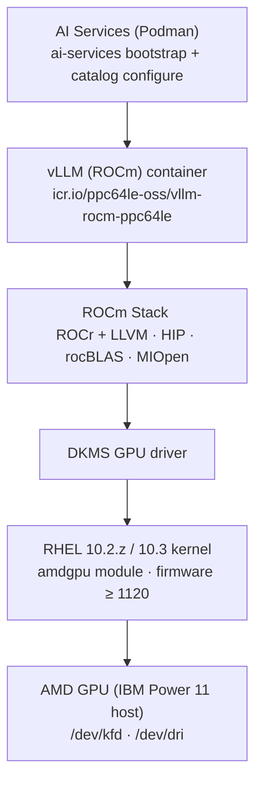

# AMD ROCm Support

## Problem Statement

AI Services on IBM Power 11 supports the IBM Spyre AIU as an accelerator for the Podman runtime. This proposal extends that support to AMD GPUs on Power 11 (ppc64le).

## Overview

This proposal defines the full software stack from firmware through to a deployable vLLM inference component, and describes all the changes required across bootstrap, validation, catalog configuration, and component assets to support AMD GPUs on IBM Power 11 (ppc64le).

The initial target hardware is the **AMD Instinct MI350 series**, and the models in scope are:

| Model | HuggingFace ID | Parameters |
|---|---|---|
| Qwen 2.5 | `Qwen/Qwen2.5-32B-Instruct` | 32B |
| Llama 3.3 | `meta-llama/Llama-3.3-70B-Instruct` | 70B |
| GPT-OSS | `gpt-oss-120B` | 120B |

## The ROCm Stack

ROCm (Radeon Open Compute) is AMD's open-source software stack for AI, machine learning, and HPC workloads on AMD GPUs. The following layers are relevant to the AIS Podman deployment on Power:

| Layer | Source |
|---|---|
| Firmware | Supported from version 1120 |
| Kernel | Officially supported from RHEL 10.3 and latest 10.2.z |
| DKMS GPU driver | [DHE (amdgpu)](https://public.dhe.ibm.com/software/server/POWER/Linux/AMD/amdgpu/RHEL/10/ppc64le/) |
| ROCm core | [DHE (ROCm)](https://public.dhe.ibm.com/software/server/POWER/Linux/AMD/ROCm/RHEL/10/ppc64le/) |
| HIP runtime | [DHE (ROCm)](https://public.dhe.ibm.com/software/server/POWER/Linux/AMD/ROCm/RHEL/10/ppc64le/) |
| Math & acceleration libraries | [DHE (ROCm)](https://public.dhe.ibm.com/software/server/POWER/Linux/AMD/ROCm/RHEL/10/ppc64le/) |
| Profiling & tooling | [DHE (ROCm)](https://public.dhe.ibm.com/software/server/POWER/Linux/AMD/ROCm/RHEL/10/ppc64le/) |
| Inference engine | [DevPi wheels](https://wheels.developerfirst.ibm.com/ppc64le/rocm/+simple/) |



## Prerequisites

Before running `ai-services bootstrap`, the host must have the AMD GPU driver and ROCm stack installed. This is a one-time manual setup step. The DKMS driver is available from the [DHE amdgpu index](https://public.dhe.ibm.com/software/server/POWER/Linux/AMD/amdgpu/RHEL/10/ppc64le/) and the ROCm stack from the [DHE ROCm index](https://public.dhe.ibm.com/software/server/POWER/Linux/AMD/ROCm/RHEL/10/ppc64le/). Once installed, `/dev/kfd` and `/dev/dri` must be present on the host before proceeding.

> Automating this install as part of `ai-services bootstrap` is planned for a future phase.

## Proposed Solution

### Host Readiness

> Part of `ai-services bootstrap`

When bootstrap detects `/dev/kfd`, it runs the AMD configuration path automatically. `ensureAMDConfigured()` validates that the host is fully ready for workloads:

- Accelerator detection via `/dev/kfd` and `lspci` device enumeration.
- Pre-flight validation covering device node availability, ROCm version, user group membership, and a `rocm-smi` sanity probe.

```go
// In bootstrap Configure()
if amd.IsApplicable() {
    if err := ensureAMDConfigured(ctx); err != nil {
        return err
    }
}
```

```go
func ensureAMDConfigured(ctx context.Context) error {
    s := spinner.New("Validating AMD GPU configuration")
    s.Start(ctx)

    if err := validators.AMDRegistry.Run(ctx); err != nil {
        s.Fail("AMD GPU validation failed")
        return err
    }

    s.Stop("AMD GPU configuration validated")
    return nil
}
```

### Catalog Integration

> Part of `ai-services catalog configure`

Wire AMD GPU awareness into the catalog configure and deploy flows:

- Extend system info reporting to surface AMD GPUs, including available device counts.
- Introduce an `acceleratorType` parameter passed to the catalog pod template. Currently [`catalog.yaml.tmpl`](../../ai-services/assets/catalog/podman/templates/catalog.yaml.tmpl) unconditionally requests `podman.io/device=/dev/vfio` - Podman cannot satisfy this on AMD hosts where no PCIe device is bound to the `vfio-pci` driver, causing the catalog pod to fail. Gating this resource request on `acceleratorType` fixes this.
- Add `tensorParallelSize` validation at configure time to ensure the requested GPU count does not exceed available hardware.

> **Note:**
> - The initial implementation reports all detected devices as available. Fine-grained per-device availability tracking is a follow-on improvement.
> - `amd.IsApplicable()` is used here (checks `/dev/kfd`) rather than `IsApplicableByPCI()` because catalog configure runs after bootstrap, so `/dev/kfd` is guaranteed to exist at this point.

```go
// Set accelerator type based on detected hardware
if amd.IsApplicable() {
    argParams["acceleratorType"] = "amd"
} else {
    argParams["acceleratorType"] = "spyre"
}
```

```yaml
# catalog.yaml.tmpl
# Before: podman.io/device=/dev/vfio: 4
# After:
resources:
  requests:
    {{- if eq .Values.acceleratorType "spyre" }}
    podman.io/device=/dev/vfio: 4
    {{- end }}
    memory: "1Gi"
```

### vLLM Component and Image

> Part of `ai-services catalog configure` (component asset deployment)

Deliver the end-to-end deployable inference component:

- Build and publish a project-owned vLLM ROCm container image for ppc64le from the wheels at the DevPi index, pinned to a semver tag.
- Add a `vllm-rocm` Podman component asset covering metadata, resource requirements, values schema (including model selection and tensor parallelism), and a pod template that mounts the required AMD GPU device nodes and shared memory.
- Add guidance for ROCm-specific environment variables in the component schema.

```yaml
# assets/components/llm/vllm-amd/podman/values.yaml
image: icr.io/ppc64le-oss/vllm-rocm-ppc64le:1.0.0
model: "meta-llama/Llama-3.3-70B-Instruct"
tensorParallelSize: 2
```

```yaml
# pod template: key device mounts
volumes:
  - name: dev-kfd
    hostPath: { path: /dev/kfd }
  - name: dev-dri
    hostPath: { path: /dev/dri }
  - name: dshm
    emptyDir: { medium: Memory, sizeLimit: 64Gi }
```

## Out of Scope

- **OpenShift:** This proposal covers the Podman runtime only. OpenShift support for AMD GPUs is not covered here.
- **Other inference runtimes:** llama.cpp and SGLang are not in scope; vLLM is the only inference engine covered here.
- **Fine-tuning or training workloads:** Only LLM inference is in scope; embeddings, rerankers, and training are not covered.
- **Other AMD GPU models:** Support for other AMD GPU cards is not guaranteed in this proposal.
- **Multi-node inference:** Single-host multi-GPU only; tensor parallelism across multiple hosts is not covered.
- **Automatic ROCm upgrades:** In-place ROCm version upgrades are not managed by AIS.

## Verification Plan

Each step has a clear exit criterion before moving to the next.

| Step | Verification |
|---|---|
| Prerequisites | `rocm-smi` reports the target device; `/dev/kfd` and `/dev/dri` are present on the host |
| Host Readiness | `ai-services bootstrap` completes without error; pre-flight validation passes |
| Catalog Integration | `ai-services catalog configure` reports the correct GPU count; vLLM component deploy is rejected with a clear error when `tensorParallelSize` exceeds available GPUs |
| vLLM Component and Image | vLLM serves a `/v1/completions` request against each of the three in-scope models |

## Open Questions

1. What is the correct SMT level for AMD GPU workloads on Power 11? Does it differ across Instinct card generations?
2. Should the fp8 model variant be restricted to hosts where `rocm-smi` reports sufficient VRAM per GPU, or is that enforced transparently by vLLM at model load time?
